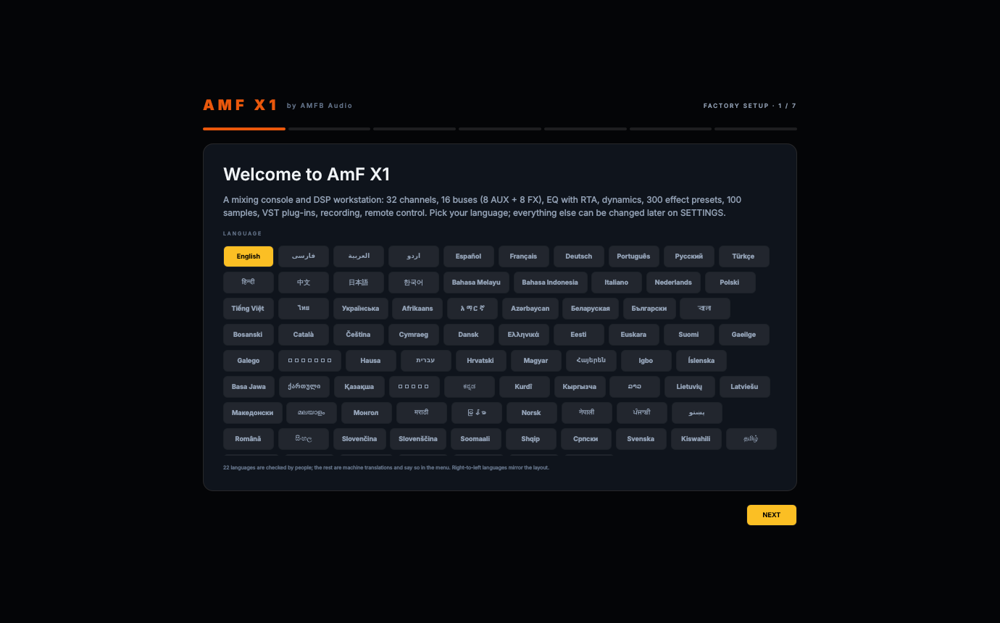
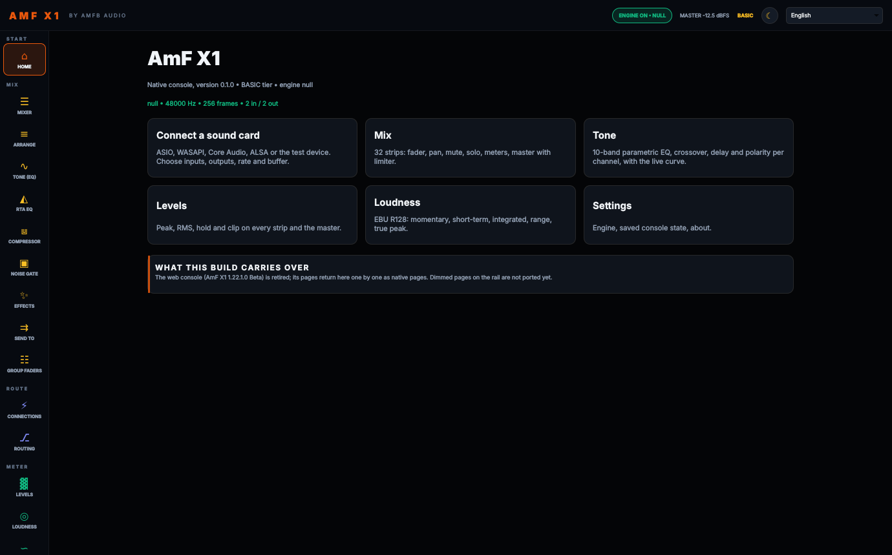

# 2. First start

## Factory setup
The first start opens the setup wizard and keeps it until FINISH: WELCOME (language) → TERMS → AUDIO (AUTO DETECT finds the best driver; only this step may be left for later) → CONSOLE (rate, block, start page, licence key) → OPERATOR (PIN, profile) → UPDATES → DONE. Run it again from SETTINGS › RERUN SETUP or after a FACTORY RESET.

## Auto start
The system is auto on: at every start the console opens the remembered sound card (SMART START walks the driver ladder if the first choice fails); with none remembered, AUTO DETECT picks one. Switch it on SETTINGS › AUTO START.

## The setup alert
When no sound card is remembered and the engine is idle, an amber bar under the header says so, with FACTORY SETUP and CONNECTIONS buttons. The faders show no input or output until a device runs.

## Light and dark
The ☾ / ☀ button in the header switches the whole console between the dark stage look and the light daylight look; the choice is remembered.

