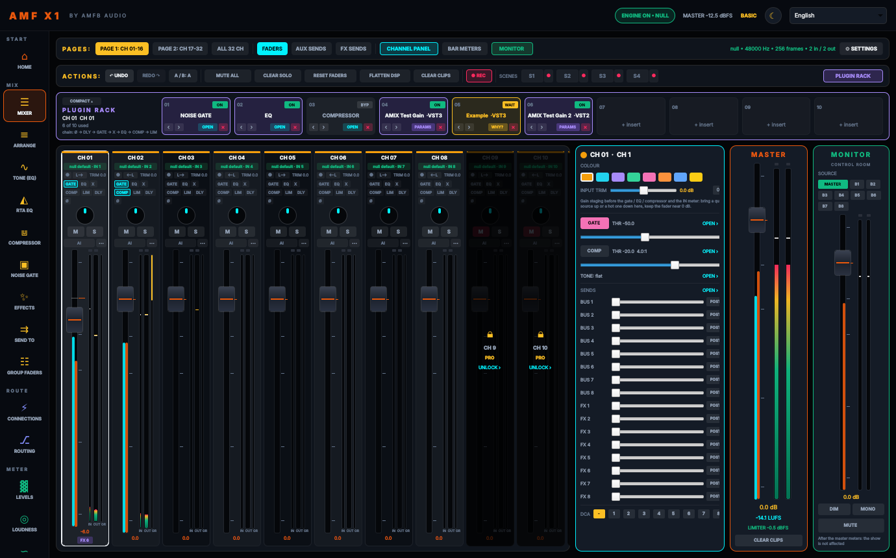
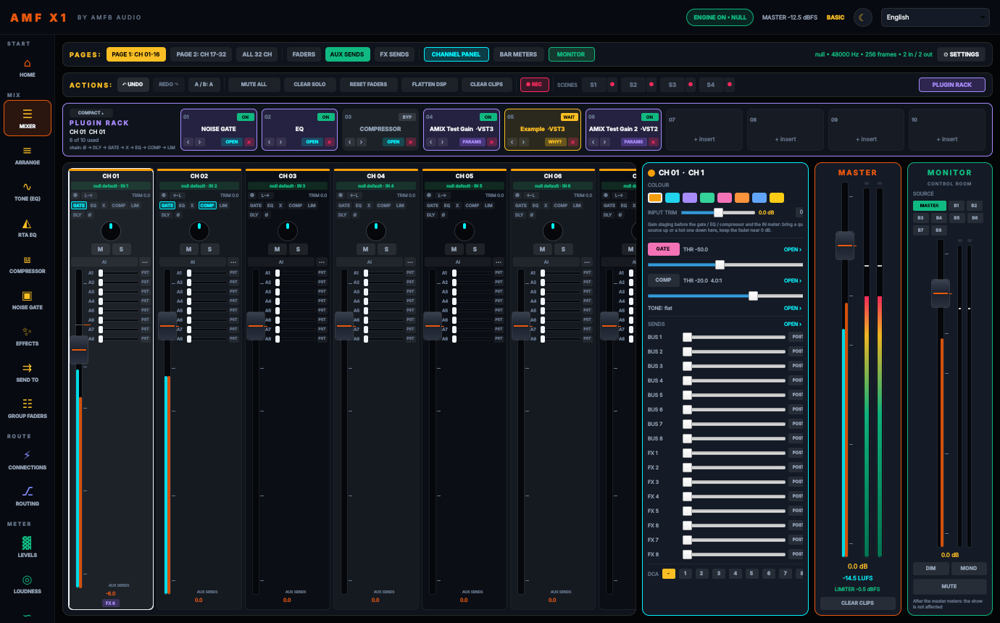

# 3. Mixer

32 strips in two pages of 16 (or all). Each strip: colour bar, name (click to rename), **INPUT chip** (which device channel feeds it, named after the device: "UM2 · IN 1"; click to pick another or none), arm / link / trim, DSP badges (GATE EQ X COMP LIM DLY Ø light when on, click opens that page), pan, M / S, the **AI chip** (automix on this strip, showing the gain it applies now; right-click opens AI MIX), ⋯ (the strip menu; also right-click anywhere on the strip), the fader, meters and the dB readout in orange.

## The fader is the meter
The fader track holds two columns: **cyan = input** as the driver delivers it (after the converter, before the fader), **orange = output** after the fader. Red above 0 dBFS or on a clip. The master fader shows RMS and peak, the monitor fader the control-room level. Beside the fader: IN, OUT and gain-reduction bars; BAR METERS switches to analogue VU faces.

## Sends on faders
FADERS / AUX SENDS / FX SENDS on the action bar. In a send view every strip shows eight mini faders (AUX 1-8 or FX 1-8) with PRE / POST next to its channel fader.

## Action bar
UNDO / REDO, A/B, MUTE ALL, CLEAR SOLO, RESET FADERS, FLATTEN DSP, CLEAR CLIPS, REC (master and armed strips to WAV), scenes S1-S4, PLUGIN RACK (six slots per channel: built-in stages, VST3, VST2). SETTINGS (⚙) holds the mixer's own options, including which strip sections to show.

## Channel panel
The side panel edits the selected strip's whole chain: colour, trim, gate, compressor, tone, sends, DCA.
