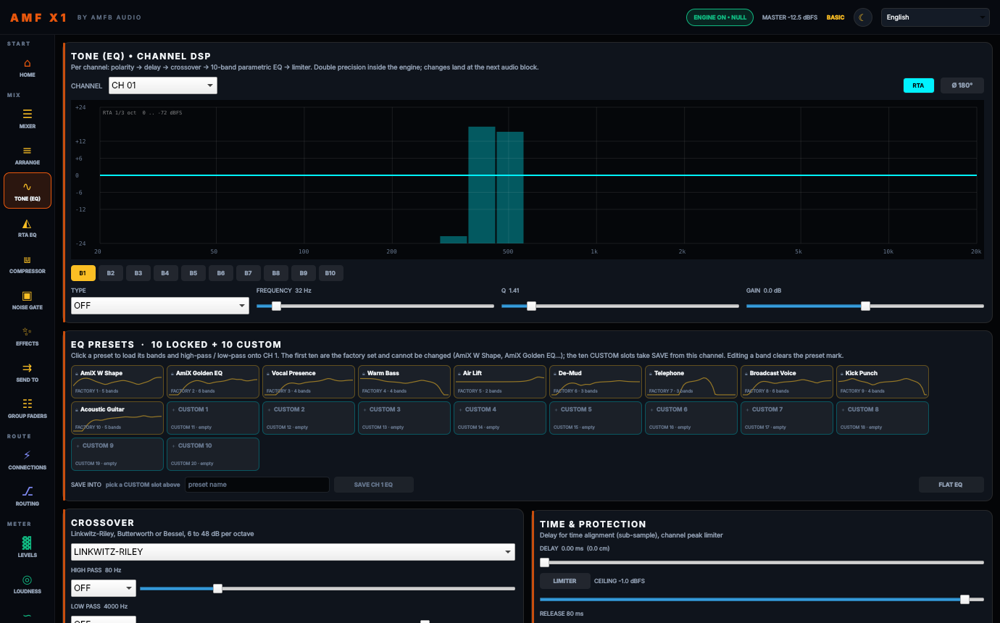
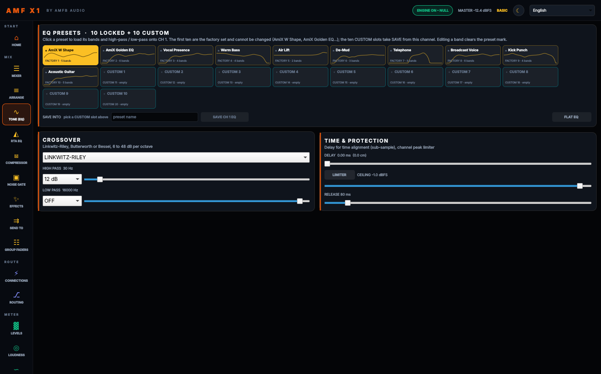
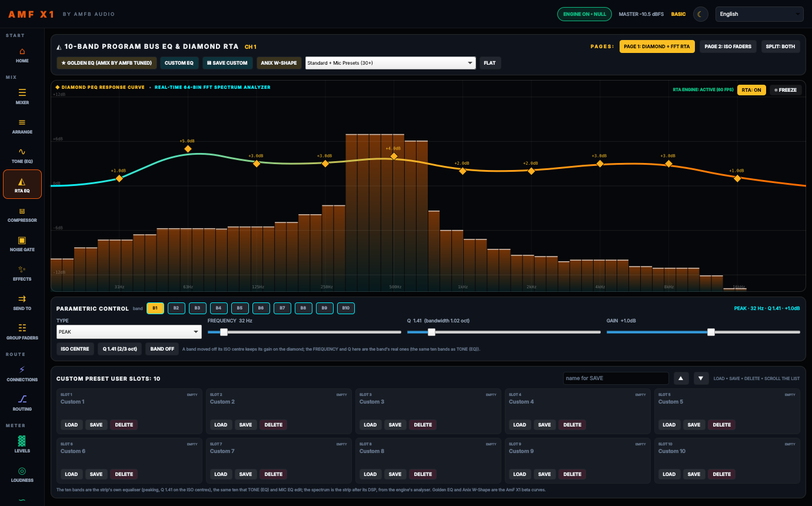

# 4. EQ

## TONE (EQ)

Ten parametric bands per channel (peak, shelves, passes, notch, all-pass), the crossover (Linkwitz-Riley / Butterworth / Bessel, 6-48 dB per octave), delay, polarity and the channel limiter, with the live response curve. **RTA** draws the strip's third-octave spectrum under the curve. Click or drag on the curve to place the selected band.

**EQ PRESETS**: ten locked factory curves (AmiX W Shape, AmiX Golden EQ, Vocal Presence, Warm Bass, Air Lift, De-Mud, Telephone, Broadcast Voice, Kick Punch, Acoustic Guitar) and ten CUSTOM slots: pick a slot, name it, SAVE from the channel; CLEAR empties it. Editing a band clears the preset mark.

## RTA EQ

The beta's 10-band program EQ: PAGE 1 the diamond curve over a 64-bar spectrum (drag a diamond, wheel for 0.5 dB; RTA ON / OFF, FREEZE), PAGE 2 ten ISO faders, SPLIT both. Toolbar: GOLDEN EQ (Amix by AMFB tuned), CUSTOM EQ / SAVE CUSTOM, ANIX W-SHAPE, the 15 standard + 15 MIC presets, FLAT. PARAMETRIC CONTROL edits the selected band's type, frequency, Q and gain. Ten CUSTOM PRESET USER SLOTS with LOAD / SAVE / DELETE.

TONE, RTA EQ and MIC EQ all edit the same ten filters of the strip.
