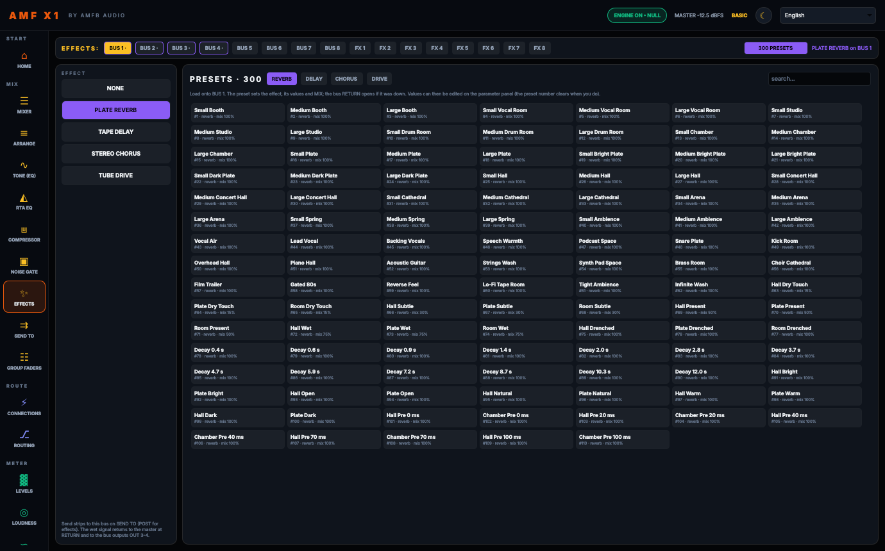
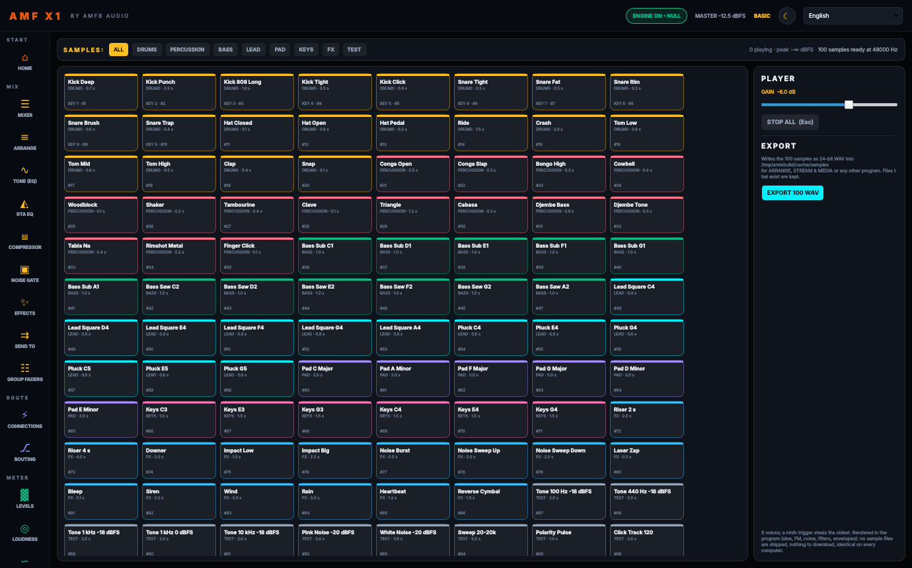

# 5. Dynamics, buses, effects, samples

**COMPRESSOR** and **NOISE GATE**: threshold, ratio, knee, attack, release, make-up / range, hold, with the transfer curve and gain-reduction meter per channel.

**SEND TO**: 16 buses, AUX 1-8 (monitor mixes, pre-fader) and FX 1-8 (effects, post-fader); each bus has a level, mute, meter, RETURN into the master and its own outputs.

**EFFECTS**: one effect per bus (plate reverb, tape delay, stereo chorus, tube drive) with the plug-in's own parameters, MIX and BYPASS. **300 PRESETS**: a browser by family (110 reverbs, 100 delays, 50 choruses, 40 drives) with search; one click loads the effect, its values and mix on the bus.

**GROUP FADERS**: 8 DCAs and 8 mute groups. **SCENES**, **PRESETS**: store and recall the console, with recall-safe strips.

**SAMPLES**: 100 built-in one-shots (drums, percussion, bass, leads, pads, keys, FX, test signals) on pads, an 8-voice player into the master, keys 1-0; EXPORT writes them as WAV into the cache folder.

