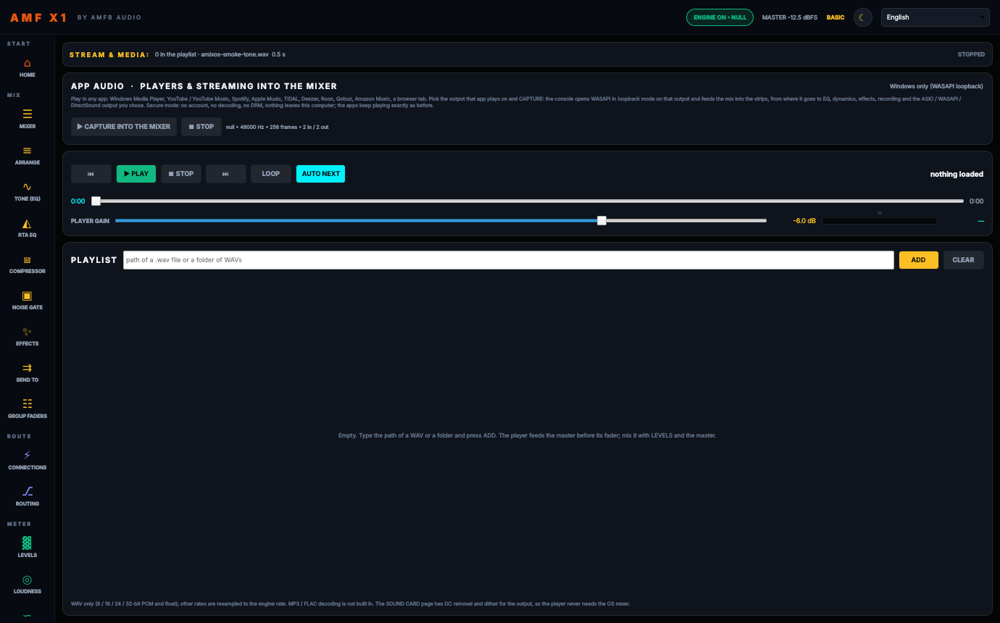

# 6. Sources

**STREAM & MEDIA**: a WAV playlist player into the master (transport, seek, gain, loop, auto-next).

**APP AUDIO** (Windows): whatever another program plays — Windows Media Player, YouTube or YouTube Music in a browser, Spotify, Apple Music, TIDAL, Deezer, Roon, Qobuz, Amazon Music — taken into the mixer as an input. Pick the output that app plays on and CAPTURE INTO THE MIXER: the console opens that output in WASAPI loopback mode and feeds the mix into channels 1-2, from where it goes through EQ, dynamics, effects and recording to the ASIO / WASAPI / DirectSound output you chose. Secure by construction: no account, no decoding, no DRM, nothing leaves the computer. Listen on a different output than the one captured, or you get a loop.

**LIVE SOURCES**: interface scan, per-input spectra, patching. **TOOLS**: tap tempo, click, test generator (sine / pink / white / polarity pulse), delay tower. **ARRANGE**: a timeline player of WAV clips with automation, exported to 24-bit WAV.
