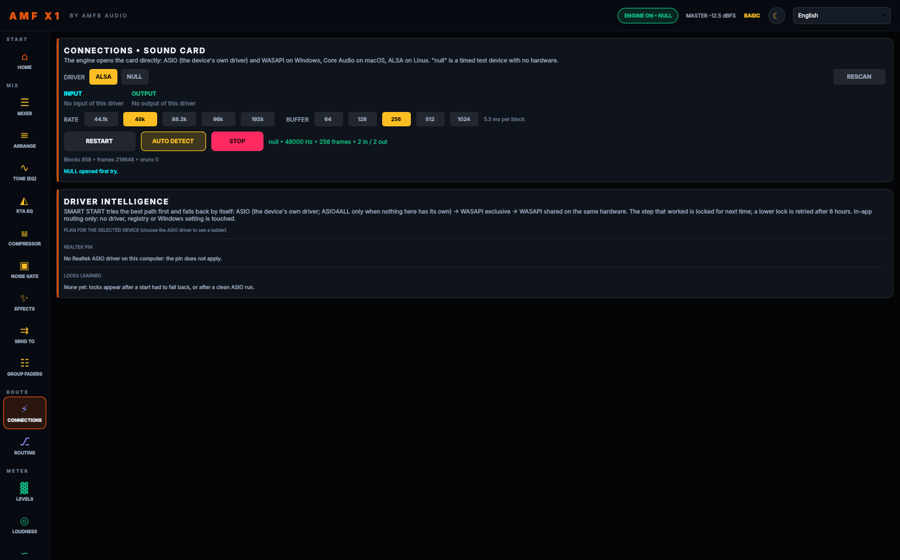
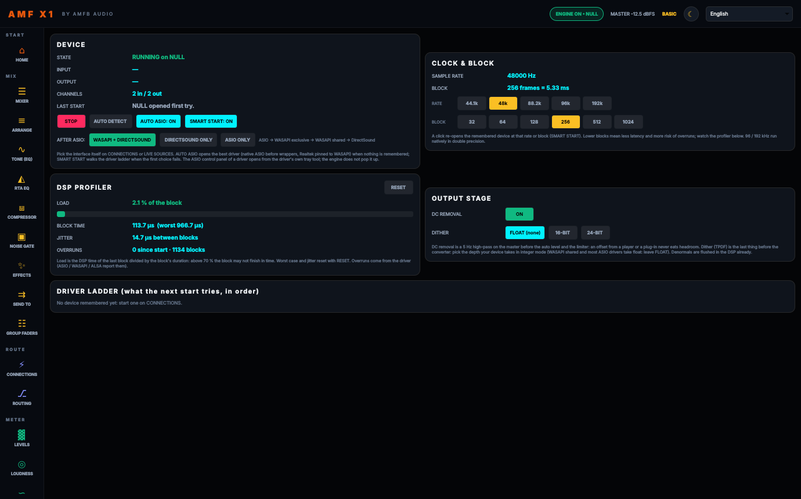
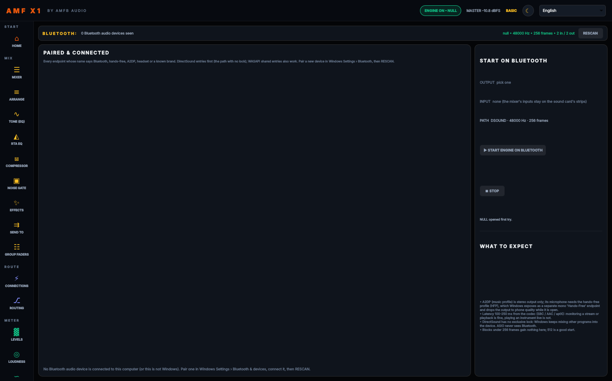

# 7. Devices and drivers

**CONNECTIONS**: backend, input and output device, rate, block, channels; START or SMART START. **ROUTING**: device inputs to strips, master / monitor / buses to device outputs.

**SOUND CARD**: the running device, clock and block (change and re-open), the DSP profiler (load, block time, jitter, overruns), the output stage (DC removal, dither), AUTO DETECT, AUTO ASIO, SMART START, and the **AFTER ASIO** policy: WASAPI + DIRECTSOUND (ASIO → WASAPI exclusive → WASAPI shared → DirectSound), DIRECTSOUND ONLY (WASAPI is optional, never a lock) or ASIO ONLY. The DRIVER LADDER panel shows what the next start will try.

Backends: **ASIO** (the device's own driver first; ASIO4ALL-style wrappers only when nothing has its own; Realtek onboard pinned to WASAPI; 32-bit drivers are listed with their bits and need the 32-bit program), **WASAPI** shared or exclusive, **DirectSound** (no lock, the Bluetooth path), ALSA, Core Audio, and a null device for tests.

**BLUETOOTH**: headsets, speakers and hands-free devices Windows exposes, DirectSound first; USE AS OUTPUT / INPUT and START ENGINE ON BLUETOOTH. Expect 100-250 ms of codec latency; A2DP is output only, the microphone needs the hands-free profile.

The engine command line checks a machine without the console: `"AmF X1.exe" --list-devices`, `"AmF X1.exe" --backend asio --out "BEHRINGER" --seconds 5`, `--install-driver` (administrator) registers the ASIO driver DLL beside the program.
