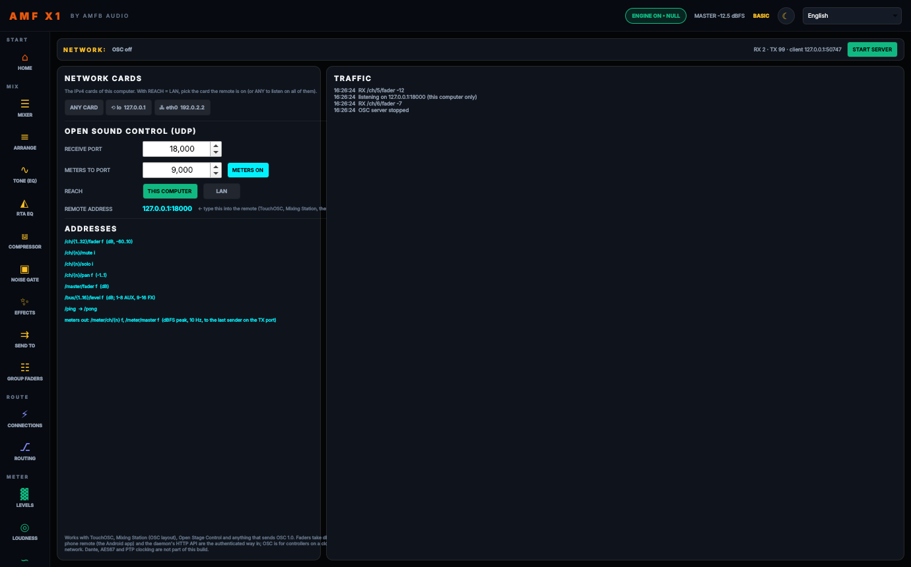

# 8. Network and remote

**NETWORK**: the computer's IPv4 cards (bind to one or any), the REMOTE ADDRESS to type into a controller, an ALLOWED IPs list (addresses or CIDR ranges; others are refused and logged), and the OSC server (UDP, off by default, this computer only unless LAN is allowed; OSC has no password or encryption, use LAN only on a network you own). Addresses: `/ch/{1..32}/fader`, `/mute`, `/solo`, `/pan`, `/master/fader`, `/bus/{1..16}/level`, meters out to the last sender.

**The daemon** (`amixos-daemon`): the engine as a local HTTP + WebSocket service for the Android remote, token-protected (`daemon.token` in the data folder), bound to 127.0.0.1; `--allow-lan` is unencrypted and only for use behind your own TLS proxy.

**Android remote**: enter the daemon's address and token; faders, mutes, meters and the device list follow the console.
