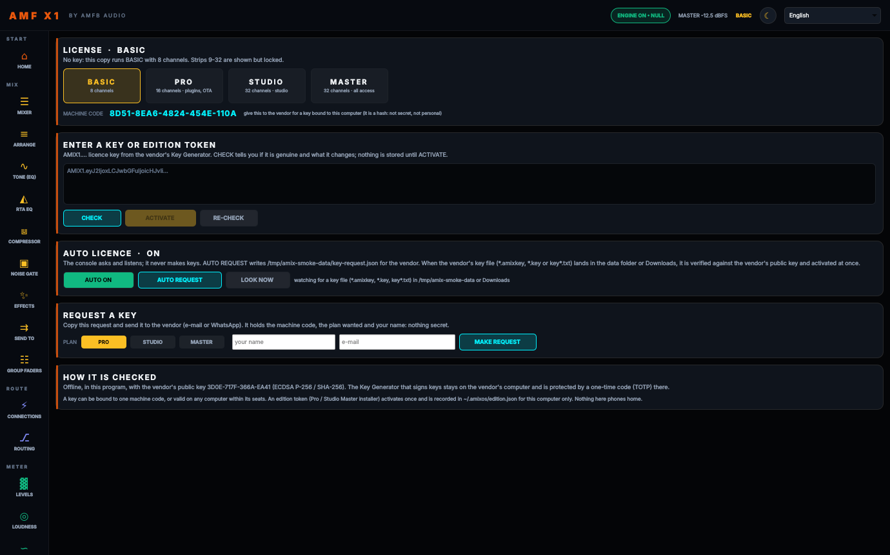

# 9. Licence, access, security

Editions: BASIC (10 channels, no key), PRO (20, plug-ins, OTA), STUDIO (32), MASTER (32, all access). A key from the vendor's Key Generator is checked offline against the vendor's public key; a key can be bound to one machine code or valid on any computer within its seats. **AUTO LICENCE**: AUTO REQUEST writes the key request file for the vendor; when the vendor's key file lands in the data folder or Downloads it is verified and activated by itself. Keys are never generated in the console.

**ACCESS**: roles (user / operator / admin) with a PIN (salted hash), a permission matrix and an audit log. **ACCOUNT**: profile, LOCK CONSOLE.

**UPDATES**: the signed manifest is verified (ECDSA P-256) before it is read; downloads are checksum-checked and saved, never run by themselves.

Nothing phones home: no accounts, no telemetry, no key generation, no DRM handling. The remote paths bind to this computer unless you open them.
