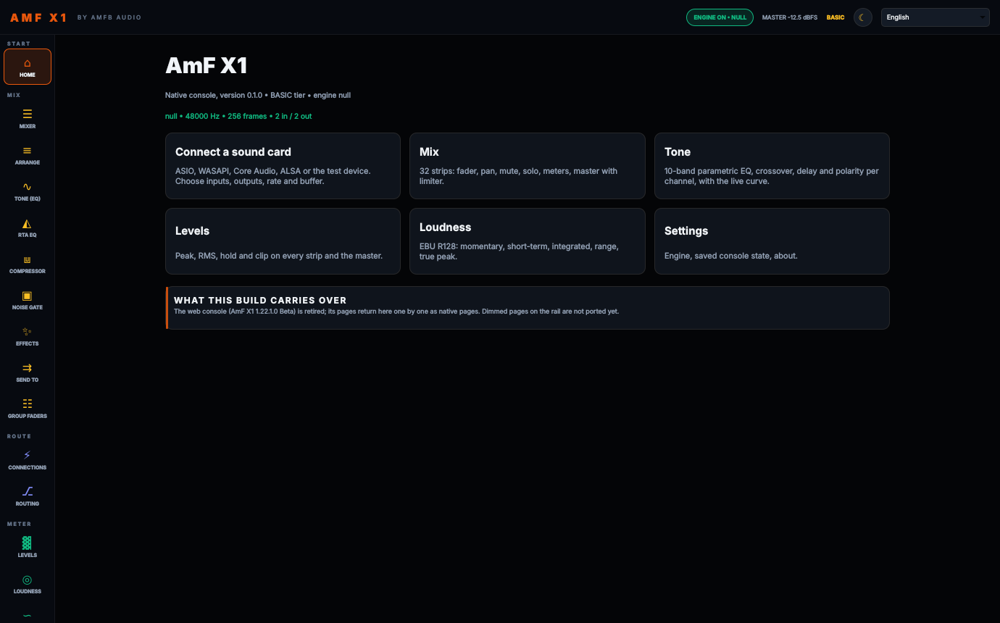

# AmF X1 by AMFB Audio — User Manual

AmF X1 is a 32-channel mixing console and DSP workstation: a native engine (ASIO, WASAPI, DirectSound, ALSA, Core Audio) under a Qt 6 console, with an Android remote and a C SDK. This folder is the manual; every picture is a real screenshot of the build it ships with.

| Chapter | What it covers |
|---|---|
| [1. Install](01-install.md) | Windows setup, Android APK, Linux tar, where the files live, signing |
| [2. First start](02-first-start.md) | Factory setup wizard, auto start, the setup alert, light / dark look |
| [3. Mixer](03-mixer.md) | Strips, faders as meters, sends on faders, input chips, AI chip, plugin rack |
| [4. EQ](04-eq.md) | TONE (EQ), RTA EQ, MIC EQ, the 20 parametric and 30 graphic presets |
| [5. Dynamics and effects](05-dynamics-effects.md) | Compressor, gate, 16 buses, 300 FX presets, samples |
| [6. Sources](06-sources.md) | WAV player, APP AUDIO capture from players and streaming apps, live sources, test tones |
| [7. Devices and drivers](07-devices.md) | CONNECTIONS, SOUND CARD, ASIO / WASAPI / DirectSound, the driver ladder, Bluetooth |
| [8. Network and remote](08-network-remote.md) | OSC, the daemon, the Android remote, allowed IPs |
| [9. Licence, access, security](09-license-security.md) | Editions, keys, auto licence, roles and PIN, what never leaves the computer |
| [10. Troubleshooting](10-troubleshooting.md) | console.log, no sound, grey interface, Defender, UM2 checks |
| [11. Keyboard](11-keyboard.md) | Shortcuts |

