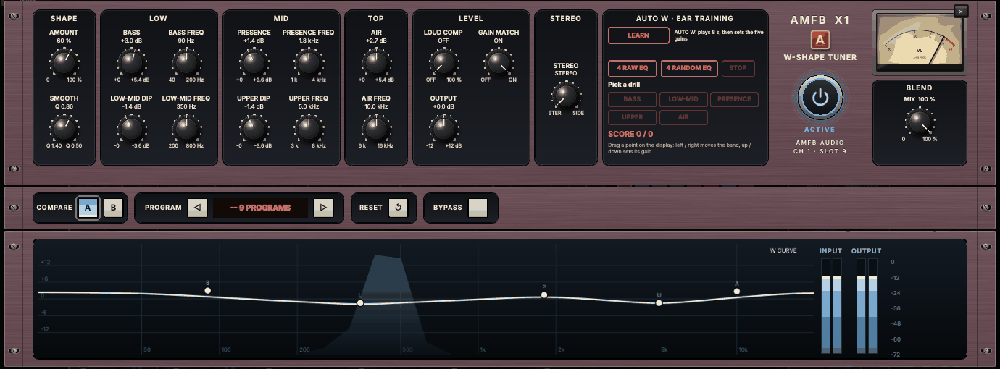
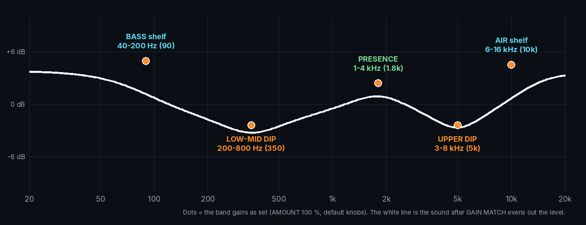
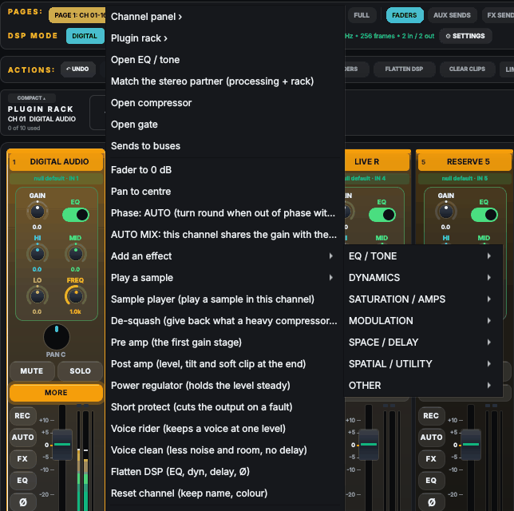
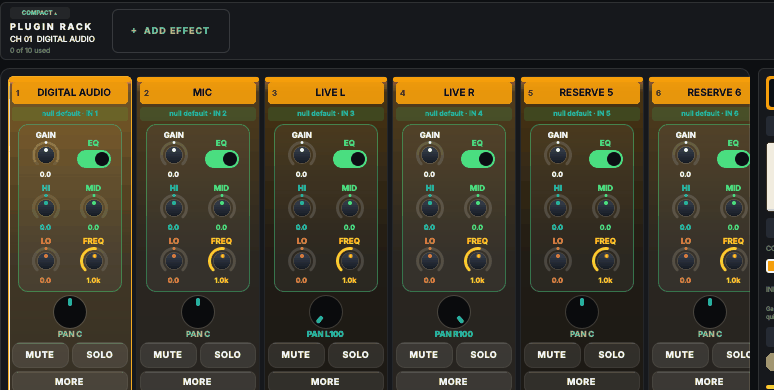
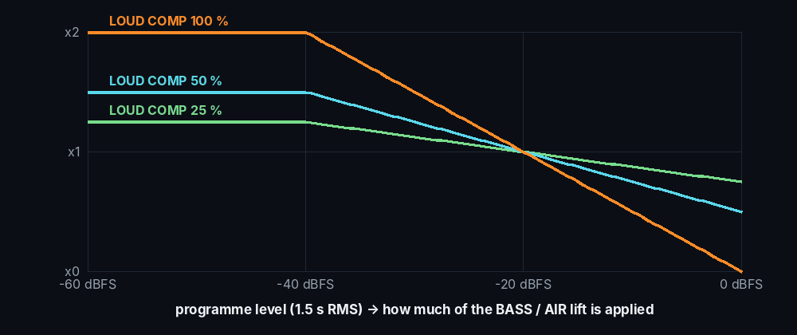

# W-SHAPE TUNER — User Guide

*AmF X1 by AMFB Audio · built-in effect · FX rack group **EQ / TONE***

W-SHAPE TUNER gives any channel the sound of a well-tuned speaker or in-ear monitor. That sound has a "W" shape: three gentle lifts with two soft dips between them.

| Band | What it does | Filter | Where (FREQ knob range, centre in **bold**) | Gain at AMOUNT 100 % |
|---|---|---|---|---|
| **BASS** | weight and warmth | low shelf | 40 – **90** – 200 Hz | 0 to +9 dB |
| **LOW-MID DIP** | clears mud and boxiness | bell (cut) | 200 – **350** – 800 Hz | 0 to −6 dB |
| **PRESENCE** | brings voices and leads forward | bell (lift) | 1 – **1.8** – 4 kHz | 0 to +6 dB |
| **UPPER DIP** | takes the edge off harshness | bell (cut) | 3 – **5** – 8 kHz | 0 to −6 dB |
| **AIR** | sparkle and openness | high shelf | 6 – **10** – 16 kHz | 0 to +9 dB |

The bands are wide and smooth, so they never ring or sound peaky. **GAIN MATCH** keeps the overall level steady while you change the curve. That matters because a louder sound always seems "better" for a moment. With the level held steady you judge the tone, not the volume.

It costs very little: five filters per channel, **zero latency**, light on the CPU.

---

## Contents

1. [Quick start (5 steps)](#quick-start-5-steps)
2. [Where to find it](#where-to-find-it)
3. [Every control](#every-control)
4. [The curve display: drag the bands](#the-curve-display-drag-the-bands)
5. [LOUD COMP](#loud-comp)
6. [GAIN MATCH](#gain-match)
7. [STEREO / MID / SIDE](#stereo--mid--side)
8. [AUTO W (LEARN)](#auto-w-learn)
9. [A/B compare](#ab-compare)
10. [Ear training: 4 RAW EQ and 4 RANDOM EQ](#ear-training-4-raw-eq-and-4-random-eq)
11. [The 9 presets](#the-9-presets)
12. [Workflows](#workflows)
13. [On the phone (Android)](#on-the-phone-android)
14. [Troubleshooting and FAQ](#troubleshooting-and-faq)
15. [Technical notes](#technical-notes)
16. [Video tutorials](#video-tutorials)

---

## Quick start (5 steps)

1. **Load it.** On the channel, click **MORE → Add an effect → EQ / TONE → W-SHAPE TUNER**. The effect goes into the channel's plug-in rack and its editor opens.
2. **Pick a starting point.** Use the **PROGRAM ◁ ▷** arrows to step through the 9 presets (SPEECH, MUSIC, LIVE PA …). Choose the one closest to your material.
3. **Set the strength with AMOUNT.** It scales the whole W at once: 0 % is flat, 100 % is the full curve. Most material sounds good between 40 % and 70 %.
4. **Fine-tune by ear.** Turn the five gains, or drag the points **B L P U A** on the curve display over the live spectrum.
5. **Check it honestly.** Leave **GAIN MATCH** on and press **BYPASS** on and off (or use **COMPARE A / B**). Keep the curve only if it sounds better at the same loudness. Then use **OUTPUT** to set the level going on down the channel.

---

## Where to find it

**Windows console.** There are two ways in:

* **MORE** on the channel strip → **Add an effect** → **EQ / TONE** → **W-SHAPE TUNER**. The effect goes into the next free rack slot and its editor opens right away.

  

* **PLUGIN RACK** bar above the channels (with **FX SENDS** / **CHANNEL PANEL** pages) → **+ ADD EFFECT** → **FX · W-SHAPE TUNER**. Then click the effect's card to open the editor.

  

The other effects in the **EQ / TONE** group are DUAL LISTEN EQ, AUTO MIC EQ, MS COLOUR EQ, ISO EQ 10, EXCITER and SUB SYNTH. To open the editor again later, click the effect's card in the plug-in rack.

**Android phone.** In the local mixer, tap a channel's **FX +** key. In the rack, tap **SLOT n · + ADD AN EFFECT** and choose **W-SHAPE TUNER** from *AmF X1 effects*. See [On the phone](#on-the-phone-android).

---

## Every control

The editor groups the knobs into **SHAPE · LOW · MID · TOP · LEVEL · STEREO**. Each knob shows its value as it plays: dB, Hz, kHz or Q. The five gain readouts already include AMOUNT, so they show exactly what is applied.

| Control | Range | Default | What it does | Tip |
|---|---|---|---|---|
| **AMOUNT** | 0 – 100 % | 60 % | Scales all five gains together. | Your "more / less W" knob. Set the shape first, then the strength. |
| **BASS** | 0 to +9 dB × AMOUNT | +3.0 dB | Low shelf lift. | On small speakers, raise **BASS FREQ** too (120–140 Hz) instead of more gain. |
| **LOW-MID DIP** | 0 to −6 dB × AMOUNT | −1.4 dB | Bell cut in the mud region. | Raise it for boomy rooms, muffled voices and boxy mics. |
| **PRESENCE** | 0 to +6 dB × AMOUNT | +1.4 dB | Bell lift for clarity and intelligibility. | A little goes a long way. Too much sounds nasal or shouty. |
| **UPPER DIP** | 0 to −6 dB × AMOUNT | −1.4 dB | Bell cut that tames harshness. Slightly narrower than the other bells (Q × 1.2). | Raise it for bright PA horns, sibilant voices and cheap tweeters. |
| **AIR** | 0 to +9 dB × AMOUNT | +2.7 dB | High shelf lift for openness. | Watch out for hiss and "s" sounds on noisy sources. |
| **SMOOTH** | Q 1.40 → Q 0.50 | Q 0.86 | Width of the three bells. Turning it up makes them wider and smoother. | Wide is musical. Turn it down only to aim at one problem. The two shelves stay at Q 0.6. |
| **OUTPUT** | −12 to +12 dB | 0.0 dB | Level trim after the curve (and after GAIN MATCH). | Use it to match the bypassed level, or to drive the next effect. |
| **BASS FREQ** | 40 – 200 Hz | 90 Hz | Moves the bass shelf. | Lower for subwoofers, higher for laptops and phones. |
| **LOW-MID FREQ** | 200 – 800 Hz | 350 Hz | Moves the mud dip. | Sweep it while listening for the boxy note. |
| **PRESENCE FREQ** | 1 – 4 kHz | 1.8 kHz | Moves the presence lift. | 1.5–2.5 kHz for speech, higher for bite on guitars. |
| **UPPER FREQ** | 3 – 8 kHz | 5.0 kHz | Moves the harshness dip. | Find the "ouch" frequency, then let the dip sit on it. |
| **AIR FREQ** | 6 – 16 kHz | 10.0 kHz | Moves the air shelf. | Higher sounds sweeter and less hissy. |
| **LOUD COMP** | OFF, 1 – 100 % | OFF | The bass and air lifts follow the programme level. | See [LOUD COMP](#loud-comp). |
| **GAIN MATCH** | ON / OFF | ON | Holds the level steady when the curve changes. | Keep it ON while you compare. |
| **STEREO** | STEREO / MID / SIDE | STEREO | Which part of the stereo signal gets the curve. | See [STEREO / MID / SIDE](#stereo--mid--side). |
| **BLEND · MIX** | 0 – 100 % | 100 % | Dry/wet blend, as on every AmF X1 effect. | 50–70 % gives a subtle "parallel" W. |
| **Power / BYPASS** | on / off | on (ACTIVE) | Takes the effect out of the signal path. | The quickest before/after check. |
| **RESET** | – | – | Puts every knob back to its default. | – |
| **PROGRAM ◁ ▷** | 9 programs | – | Steps through the factory presets. | See [The 9 presets](#the-9-presets). |

The **FREQ** knobs move on a musical (logarithmic) scale. At the knob centre each band sits at its classic place: 90 Hz, 350 Hz, 1.8 kHz, 5 kHz and 10 kHz.

---

## The curve display: drag the bands

The lower panel draws the **W CURVE** in white over the **live spectrum** of the channel (the soft blue "mountain"), with INPUT and OUTPUT meters on the right. The curve is worked out with the same filters the engine runs, so what you see is what you hear. It includes GAIN MATCH, OUTPUT, the level-following part of LOUD COMP and any ear-training boost.

Each band has a point with a letter: **B** (BASS), **L** (LOW-MID), **P** (PRESENCE), **U** (UPPER), **A** (AIR).

* **Drag left / right** to move the band. This turns its FREQ knob, and only inside that band's range.
* **Drag up / down** to set its gain. This turns its gain knob. A lift band cannot be dragged below 0 dB and a dip band cannot go above 0 dB, so the curve always stays a W.
* A point grabs when you click within about 22 pixels of it. While you hold it, the point turns red.
* The points show each band's gain as set. The white line can sit a little lower than the points, because GAIN MATCH evens out the level.

**Reading the spectrum.** Look for a hump that sticks out where you hear a problem: a big bump at 200–500 Hz on a muddy mix, or a bright ridge at 3–6 kHz on a harsh one. Put **L** or **U** on it. Where the spectrum falls away (a thin bottom, dull top), lift with **B** or **A**.

---

## LOUD COMP

Our ears hear less bass and less top at low volume. LOUD COMP makes the **BASS** and **AIR** lifts follow how loud the programme is playing:

* The level is measured as an RMS level over about **1.5 s**, then smoothed again over **0.3 s**, so nothing pumps or zips.
* At **−20 dBFS RMS** the curve is exactly as you set it.
* **Quieter** than that, the bass and air lifts grow. At −40 dBFS and below they reach (1 + LOUD COMP) times the setting, so ×2 at 100 %.
* **Louder** than that, they shrink. At 0 dBFS they reach (1 − LOUD COMP) times the setting, so flat at 100 %.
* No lift ever goes above **+15 dB**. Below **−70 dBFS** the factor holds where it is, so the noise floor is never lifted.
* LOW-MID, PRESENCE and UPPER are not affected.

**Use it for** background music, late-night listening, playback that people turn up and down, and car audio. The BACKGROUND (LOW LEVEL) preset uses 80 % and CAR uses 50 %. Leave it **OFF** for mixing decisions, when you want the curve to stay put.

---

## GAIN MATCH

With **GAIN MATCH ON** (the default), the tuner measures the curve's average gain across a pink (natural) spectrum from 40 Hz to 16 kHz. It then removes that gain, so a bigger W does not simply sound louder. With it **OFF**, the curve plays at its own level. That is usually a few dB louder, because three of the five bands lift.

* Keep it **ON** while comparing presets, A/B slots or bypass. Otherwise "louder" wins every time.
* Turn it **OFF** only if you want the W's own loudness, for example to make up for a speaker that plays quietly. Then set **OUTPUT** by ear.

---

## STEREO / MID / SIDE

| Mode | The curve works on | Use it when |
|---|---|---|
| **STEREO** | both channels (left and right alike) | almost always: the normal setting |
| **MID** | what the two sides share: centre voice, kick, bass | you want a clearer voice or punchier centre without changing the width |
| **SIDE** | what differs between the sides: width, room, ambience | you want a wider, airier stereo image while the centre stays untouched |

In MID or SIDE mode the other part passes through exactly as it came in. On a mono source, SIDE does nothing because there is no side signal.

---

## AUTO W (LEARN)

AUTO W listens to the channel and sets the five gains for you.

1. Play typical material through the channel: a full song, or someone speaking normally.
2. Press **LEARN**. The key changes to **LISTENING** and the panel shows *Listening to the programme … %*.
3. After **8 seconds** it compares the five regions with a neutral (pink-noise) balance. It **lifts** BASS, PRESENCE or AIR where the source is short, and **dips** LOW-MID or UPPER where it is too strong. Then it sets the five gain knobs and switches itself off. The knobs, the points and the curve show the result.
4. Fine-tune by ear. AMOUNT still scales what AUTO W chose.

Good to know:

* It listens to the **input**, before the curve, as a mono sum (L + R).
* It measures each band at its **current FREQ** setting, so move the bands first if you want it to judge other places.
* The gains it sets stay inside each knob's range at the present AMOUNT. With AMOUNT very low, the range is small, so set AMOUNT to about 60 % first.
* If almost nothing played (below about −80 dBFS), it keeps your gains unchanged.
* It only sets gains. FREQ, SMOOTH, LOUD COMP, OUTPUT and STEREO are left alone.

---

## A/B compare

**COMPARE A / B** keeps two complete settings of the tuner:

1. Set up a sound on **A**.
2. Press **B** and make a different version. B starts from where A was.
3. Switch **A ↔ B** while the music plays. Each press swaps every knob at once.

The two slots are **kept with the effect**. They are saved with the channel and come back the next time you open the editor. With **GAIN MATCH ON**, both slots play at a fair, matched loudness. A good habit: put AUTO W's result on **A** and your own version on **B**, then decide.

---

## Ear training: 4 RAW EQ and 4 RANDOM EQ

The **AUTO W · EAR TRAINING** panel teaches you what each band sounds like. Both drills boost one band by **+6 dB** on top of your curve, and the boost is not scaled by AMOUNT. Bells use Q 1.0 and the shelves use Q 0.6, each at the band's current frequency.

**4 RAW EQ: hear each band in turn.**
Press **4 RAW EQ**. The panel shows **NOW BOOSTED: BASS**, then LOW-MID, PRESENCE, UPPER and AIR, changing every **2.5 seconds**. Then it stops by itself. Listen to how each region changes the sound. Press it again, or **STOP**, to end early.

**4 RANDOM EQ: the quiz.**
Press **4 RANDOM EQ**. One band, chosen at random, is boosted and the panel asks **WHICH BAND IS BOOSTED?** Click your answer: **BASS · LOW-MID · PRESENCE · UPPER · AIR**.

* The panel shows **RIGHT: <band>**, or **IT WAS <band>** if you missed.
* **SCORE x / y** counts your right answers out of all answers.
* While a question is open, the curve, the points and the readouts do **not** show the hidden boost, so the display never gives the answer away. Once you answer, the boost is drawn on the curve for a moment.
* The next hidden band starts about 2 seconds after your answer. Press **STOP** (or 4 RANDOM EQ again) to finish.
* The score starts again at 0 / 0 each time the editor is opened for an effect.

**Tips for training:** use full-range music you know well, at a moderate level. Toggle BYPASS to hear the difference. Aim for 8 out of 10 before moving the bands to new places to make it harder.

**LIVE MODE lock.** While **LIVE MODE** is on (a stream or show), ear training is **disabled**, so no test boost can reach the audience. The panel shows *Ear training is off in LIVE MODE*, the drill keys are greyed out, and a drill that was running stops at once. Closing the editor also stops any drill. AUTO W still works in LIVE MODE.

---

## The 9 presets

Step through them with **PROGRAM ◁ ▷** in the editor, or choose them from the **PRESETS** menu on the phone (marked ★). Factory preset numbers are **601–609**, in the category **W-Shape**. All of them have GAIN MATCH ON, STEREO mode and OUTPUT 0 dB.

| # | Preset | AMOUNT | BASS | LOW-MID DIP | PRESENCE | UPPER DIP | AIR | SMOOTH | LOUD COMP | Intended use |
|---|---|---|---|---|---|---|---|---|---|---|
| 601 | **SPEECH** | 50 % | +0.9 dB @ 97 Hz | −2.0 dB @ 331 Hz | +2.1 dB @ 1.8 kHz | −1.4 dB @ 5 kHz | +1.3 dB @ 9.5 kHz | Q 0.86 | off | Spoken word, presenters, meetings: clear and not boomy |
| 602 | **PODCAST** | 55 % | +2.2 dB @ 83 Hz | −2.0 dB @ 331 Hz | +2.0 dB @ 1.7 kHz | −1.8 dB @ 5 kHz | +2.0 dB @ 10 kHz | Q 0.81 | off | Close-mic voice with warmth: radio-style intimacy |
| 603 | **MUSIC** | 60 % | +3.2 dB @ 90 Hz | −1.4 dB @ 350 Hz | +1.4 dB @ 1.8 kHz | −1.4 dB @ 5 kHz | +3.0 dB @ 10 kHz | Q 0.86 | off | General music playback: the classic W |
| 604 | **LIVE PA** | 55 % | +1.7 dB @ 106 Hz | −2.3 dB @ 350 Hz | +1.7 dB @ 1.8 kHz | −2.1 dB @ 4.8 kHz | +1.5 dB @ 9 kHz | Q 0.95 | off | Venues and PA: less room mud, less horn harshness |
| 605 | **SMALL SPEAKER** | 70 % | +5.0 dB @ 134 Hz | −2.1 dB @ 380 Hz | +2.1 dB @ 1.8 kHz | −1.3 dB @ 5 kHz | +2.5 dB @ 9 kHz | Q 0.86 | off | Laptops, phones and small Bluetooth boxes: bass placed where they can play it |
| 606 | **CAR** | 65 % | +2.3 dB @ 90 Hz | −2.5 dB @ 350 Hz | +2.1 dB @ 1.8 kHz | −1.8 dB @ 5 kHz | +3.5 dB @ 10 kHz | Q 0.86 | 50 % | In-car listening: road noise masks lows and highs, level changes often |
| 607 | **BACKGROUND (LOW LEVEL)** | 60 % | +3.8 dB @ 90 Hz | −1.1 dB @ 350 Hz | +1.3 dB @ 1.8 kHz | −1.1 dB @ 5 kHz | +3.8 dB @ 10 kHz | Q 0.77 | 80 % | Shops, bars and lobbies at low volume: full sound when quiet |
| 608 | **GENTLE** | 30 % | +1.5 dB @ 90 Hz | −0.7 dB @ 350 Hz | +0.7 dB @ 1.8 kHz | −0.7 dB @ 5 kHz | +1.3 dB @ 10 kHz | Q 0.59 | off | A light touch for finished mixes or when unsure |
| 609 | **STRONG** | 100 % | +7.2 dB @ 90 Hz | −3.6 dB @ 350 Hz | +3.6 dB @ 1.8 kHz | −3.6 dB @ 5 kHz | +6.3 dB @ 10 kHz | Q 1.04 | off | The full effect: demos, very flat sources, or dull rooms |

*Gains are the values applied, with AMOUNT included, as the knobs show them.*

---

## Workflows

### Speech (presenter, meeting, podcast)
1. Load **SPEECH** (or **PODCAST** for a close, warm mic).
2. Sweep **LOW-MID FREQ** between 250 and 450 Hz and stop where the voice sounds least boxy. Raise **LOW-MID DIP**.
3. Set **PRESENCE FREQ** to 1.8–2.5 kHz for intelligibility. Keep PRESENCE moderate.
4. If "s" sounds bite, lower **AIR** or raise **UPPER DIP**. For heavy sibilance, add a DE-ESSER after the tuner.
5. On a stereo bus with the voice in the centre, try **MID** mode.

### Music (playback, DJ, background bed)
1. Load **MUSIC**. Press **LEARN** during a typical song and let AUTO W suggest the gains.
2. Store that on **A**. On **B**, make your own version. Compare with GAIN MATCH ON.
3. For width and sparkle without touching the vocal, use **SIDE** mode with a little AIR.

### Live PA
1. Load **LIVE PA** on the master or a playback channel.
2. Look at the live spectrum while music plays. Put **L** on the room's boom (often 120–300 Hz in halls) and **U** on the horns' harshness (3–6 kHz).
3. Keep **SMOOTH** high (wide bells). Narrow cuts at high level can sound unnatural.
4. Ear training is locked in **LIVE MODE**, so nothing can be boosted by accident during the show.
5. For feedback, use FEEDBACK KILLER. W-SHAPE is for tone.

### Small speakers (laptop, phone, Bluetooth, small monitors)
1. Load **SMALL SPEAKER**. The bass shelf moves up to about 134 Hz, where small drivers can still play.
2. If the speaker rattles, lower **BASS** or raise **BASS FREQ** further. Do not push 40–80 Hz into a speaker that cannot play it.
3. Keep **AIR FREQ** around 9–10 kHz. Small tweeters often sound harsh above that.
4. For quiet listening, add **LOUD COMP** at 30–60 %.

---

## On the phone (Android)

The phone's local mixer runs the same engine with the same W-SHAPE TUNER:

1. Tap the channel's **FX +** key (it shows **FX · n** when effects are loaded).
2. Tap **SLOT n · + ADD AN EFFECT** → *AmF X1 effects* → **W-SHAPE TUNER**. On a stereo-linked pair, both channels get it.
3. The effect appears as a plug-in face with a **power LED** (bypass), **PRESETS**, a **MIX** knob, and a knob for each control with its live value (dB, Hz, %).
4. **PRESETS** lists INIT (every knob to its default), your own saved presets, SAVE AS PRESET…, and the nine factory W-Shape presets marked **★** (SPEECH … STRONG). They come from the preset pack built into the app. **★ PRESET PACK EFFECT** in the rack adds a factory preset straight into the first free slot.

5. Above the knobs, the W-SHAPE face has the same tools as the Windows editor:
   * **The W curve** with its five points: drag a point left / right to move the band within its range, up / down for its gain.
   * **AUTO W** listens for 8 seconds (progress in %) and sets the five gains.
   * **A**, **B** and **COMPARE**: two settings kept with the effect, in the same format as the console.
   * **STEREO · MID · SIDE** and **PRESETS** (the nine factory presets).
   * **4 RAW EQ**, **4 RANDOM EQ** and **STOP**, with the answer keys and **SCORE x / y**. The hidden boost is not drawn until you answer.

A sound you build on the console plays the same on the phone, and the other way round.

---

## Troubleshooting and FAQ

**I can't hear any difference.**
Check the effect is **ACTIVE** (not bypassed), **MIX** is above 0 %, and **AMOUNT** is above 0 %. With GAIN MATCH on, the change is in tone, not volume. Listen to the balance, not the loudness. Try STRONG to hear the full effect.

**It got quieter when I turned the curve up.**
That is GAIN MATCH doing its job: it takes back the extra loudness of the lifts. Raise **OUTPUT** if you need more level, or turn GAIN MATCH off.

**MID / SIDE does nothing.**
On a mono source, or a channel where left and right are the same, SIDE has nothing to work on. MID then sounds the same as STEREO.

**The 4 RAW EQ / 4 RANDOM EQ keys are greyed out.**
LIVE MODE is on. Ear training is locked during a show. Stop LIVE MODE to train.

**AUTO W changed nothing.**
The input was silent (below about −80 dBFS) during the 8 seconds, or the source already matched the neutral balance. Play typical material at a normal level and press LEARN again. A low AMOUNT also limits what AUTO W can set.

**AUTO W gave a big bass lift on a thin source.**
That is what it measures. Lower BASS, or lower AMOUNT, which scales everything AUTO W chose.

**LOUD COMP makes the bass come and go.**
It follows the programme over 1.5 s by design. Lower LOUD COMP, or set it to OFF for a fixed curve.

**Harsh "s" sounds after adding AIR.**
Lower AIR, raise **AIR FREQ** (12–16 kHz is sweeter), or raise **UPPER DIP**.

**Booming on a small speaker.**
Raise **BASS FREQ** and lower **BASS**. Small boxes cannot play deep bass, and the extra energy only causes distortion.

**My old sessions sound different after the update.**
They should not. See [old-settings compatibility](#technical-notes).

**Can I use it on the master bus?**
Yes. It is a normal rack effect on any channel, bus or the master. Use GENTLE or a low AMOUNT on finished mixes.

---

## Technical notes

* **Filters:** five biquads per channel, as in the [band table](#w-shape-tuner--user-guide) above: a low shelf (Q 0.6), three bells (Q from SMOOTH, 1.40 → 0.50; UPPER DIP uses Q × 1.2) and a high shelf (Q 0.6). An optional sixth filter is the ear-training boost: +6 dB, Q 1.0 for bells, 0.6 for shelves.
* **Frequencies:** each FREQ knob moves on a log scale. The knob centre is exactly the classic place: 90 Hz, 350 Hz, 1.8 kHz, 5 kHz, 10 kHz. The ranges are 40–200 Hz, 200–800 Hz, 1–4 kHz, 3–8 kHz and 6–16 kHz.
* **GAIN MATCH:** removes the curve's average power gain, measured on 1/3-octave points from 40 Hz to 16 kHz (a pink spectrum). It is worked out on the curve as set, so LOUD COMP's level-following part stays audible.
* **LOUD COMP:** 1.5 s RMS level detector and 0.3 s smoothing. The coefficients are updated every 64 samples. Reference level −20 dBFS; factor 0–2; lifts capped at +15 dB; holds below −70 dBFS. Only BASS and AIR follow it.
* **AUTO W:** 8 s of the input (mono sum, before the curve). Five band-pass detectors (Q 1.0) sit at the bands' current frequencies. Each region's level is compared with the average of the five. The gains are set within range at the present AMOUNT (minimum 5 % is assumed).
* **STEREO / MID / SIDE:** M = (L + R) / 2, S = (L − R) / 2. In MID or SIDE mode only that part is filtered, then L/R are rebuilt.
* **Latency:** **0 samples.** Pure IIR filtering with no look-ahead, so it is safe anywhere in a live chain.
* **CPU:** very light: five (six while training) biquads per channel, plus a level detector when LOUD COMP is on.
* **Old-settings compatibility:** the first eight controls (AMOUNT, BASS, LOW-MID DIP, PRESENCE, UPPER DIP, AIR, SMOOTH, OUTPUT) keep their ids, order and defaults. The new controls come after them, with defaults that sound exactly like the original tuner: FREQ knobs at their centres, LOUD COMP off, GAIN MATCH on, STEREO mode, no training boost, LEARN off. A session or preset saved before the update loads and sounds the same. The factory presets are numbered 601–609, after every older preset, so no older preset number changed.
* **Internal id:** effect kind `wshape`, shown as **W-SHAPE TUNER**, with 18 parameters. The extra two are TRAIN and LEARN, which the editor's panel drives.

---

## Video tutorials

Seven short captioned videos (1920×1080, no voice-over) are in [`videos/`](videos/):

| # | Video | Covers |
|---|---|---|
| 1 | [Getting started](videos/W-SHAPE-Tutorial-1-Getting-started.mp4) | Loading it from EQ / TONE, AMOUNT, bypass, OUTPUT |
| 2 | [The five bands](videos/W-SHAPE-Tutorial-2-The-five-bands.mp4) | BASS, LOW-MID DIP, PRESENCE, UPPER DIP, AIR, SMOOTH, with audio demos |
| 3 | [Moving the bands](videos/W-SHAPE-Tutorial-3-Moving-the-bands.mp4) | FREQ knobs, dragging points, reading the spectrum |
| 4 | [LOUD COMP and GAIN MATCH](videos/W-SHAPE-Tutorial-4-Loud-comp-and-gain-match.mp4) | Level-aware W and fair loudness |
| 5 | [AUTO W and A/B](videos/W-SHAPE-Tutorial-5-Auto-W-and-AB.mp4) | LEARN, then compare A against B |
| 6 | [Ear training](videos/W-SHAPE-Tutorial-6-Ear-training.mp4) | 4 RAW EQ, the 4 RANDOM EQ quiz, scoring, LIVE MODE lock |
| 7 | [Presets, stereo modes and workflows](videos/W-SHAPE-Tutorial-7-Presets-stereo-and-workflows.mp4) | 9 presets, STEREO/MID/SIDE, recipes, the phone |

A PDF of this guide is in [`W-SHAPE-TUNER-Guide.pdf`](W-SHAPE-TUNER-Guide.pdf).
